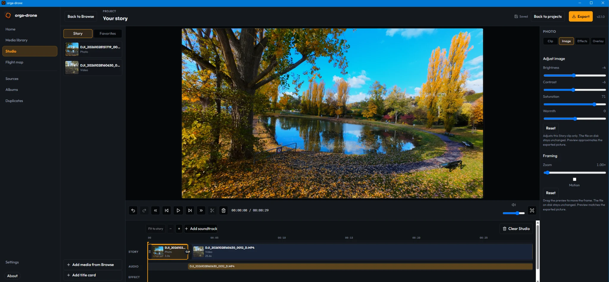
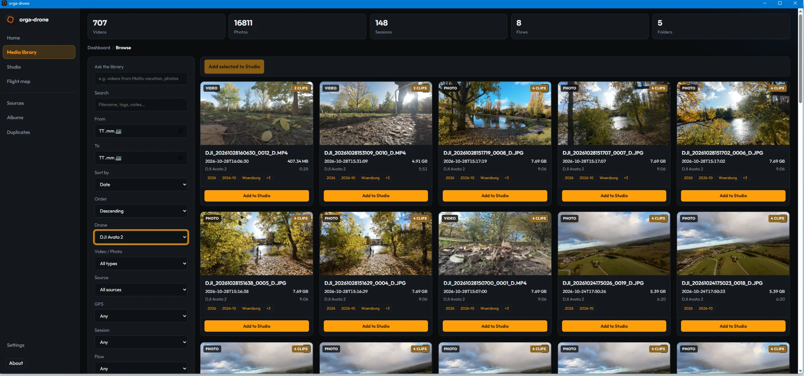
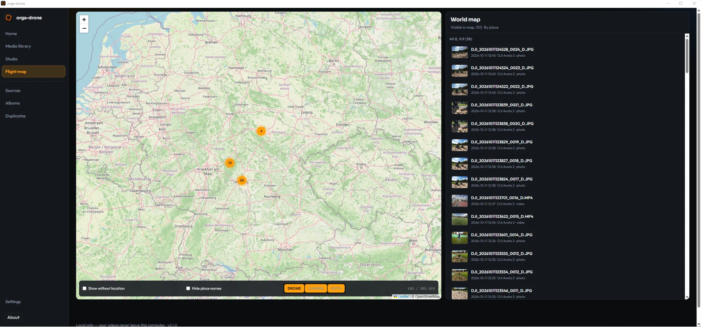

# Orga Drone

### Your flights. Your footage. Your stories.

**A local-first drone media library with flight metadata, telemetry and map exploration.**

Organize your footage, rediscover where you flew, and create videos from your favorite moments — on your own computer.

**Open source · No account required · Your original media stays on your disk**

[**Current Version – Buy via itch.io**](https://magehawks.itch.io/orga-drone) · [**Explore the source**](https://github.com/Magehawks/orga-drone) · [**Join Discord**](https://discord.gg/8Qa4FZYZq)

## Made for the moments behind your flights

Drone footage is easy to capture and surprisingly hard to find again. Orga Drone brings your local photos, videos and available flight metadata together in one place. Browse your adventures, explore GPS locations and put together a story without moving your library into the cloud.

## Organize your footage

Add your existing media folders and browse photos and videos in a single library. Filter by date, camera, GPS availability and more; keep favorites, tags, notes and albums.

## Explore where you flew

Discover GPS-tagged media on an interactive map. Where telemetry is available, Orga Drone can also show flight tracks alongside video playback.

*Map and telemetry features depend on GPS data in your media. Map tiles may require an internet connection.*

## Turn moments into stories

Use the built-in Studio to arrange clips and photos, trim footage, add titles, transitions, overlays, music and image adjustments, then export a local MP4. Orga Drone is designed for personal flight stories — not to replace a professional video editor.

## Your media stays yours

- **Local-first:** your photos and videos remain in the folders you choose.
- **No cloud account:** browse and edit without signing in.
- **Non-destructive workflow:** editing and exporting do not overwrite your original media.
- **Open source:** inspect the code, report issues or contribute under the [MIT license](LICENSE).

## Get started on Windows

1. [Get the current Windows version on itch.io](https://magehawks.itch.io/orga-drone).
2. Extract the ZIP and start `orga-drone.exe` from the extracted folder (keep `_internal` alongside it).
3. Add a folder containing your photos and videos.
4. Open the library, explore the map or create your first Studio project.

**Other platforms:** macOS and Linux can run the Python application from source; packaged desktop downloads are currently Windows-focused.

[Installation and developer instructions](docs/PRODUCT_VISION.md)

## Help shape Orga Drone

I'm looking for **10 drone pilots to try Orga Drone for free** and share honest feedback using their own footage. DJI, FPV and action-camera users are welcome.

Interested? [Join the Discord](https://discord.gg/8Qa4FZYZq) and mention that you'd like to test Orga Drone,.

Found a bug or have an idea? [Open an issue](https://github.com/Magehawks/orga-drone/issues).

## Project and documentation

Orga Drone is developed in the open. DJI Avata 2 has been the primary development reference; compatibility and telemetry coverage can vary by camera and file format.

- [Product vision](docs/PRODUCT_VISION.md)
- [Technical documentation and setup](docs/PRODUCT_VISION.md)
- [Issues and feature requests](https://github.com/Magehawks/orga-drone/issues)
- [Get the Windows app on itch.io](https://magehawks.itch.io/orga-drone)

---

Built for real flights, real footage and the stories worth keeping.

