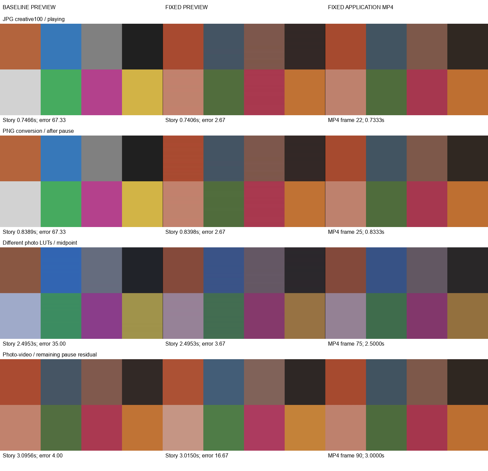

# Photo LUT playback and crossfade validation

## Decision

**NO-GO for strict preview/export parity sign-off or release approval.** The
photo lifecycle repair is demonstrated, but the unchanged strict color gate
still fails in the cases below. The bounded photo gate passes. This PR does
not fix the existing video timing/color limitations or authorize a release.

The approved scope is the Product Owner's task **Fix photo LUT preview lifecycle
and crossfade parity**. No separate implementation issue was supplied. Local
read-only product, engineering and independent implementation reviews approved
the bounded implementation. Independent review of the actual GitHub PR remains
pending under the workflow introduced by #318.

## Build and environment

- Baseline production: `7dd593000844ab7b6832bb24608f2629ec515c1c` (includes #316).
- Tested implementation/build: `a78598693aedde1ef8a2c9355be48c9134681eb4`.
- Latest develop `01da5cbfc42cdd3f8b0b3ec2e7a52ee328ead67d` (#318) was integrated
  after the build. Its changes are workflow/documentation only. The production
  source and packaging spec are identical between the tested build and this
  branch after integration. Later changes add validation evidence/probe options.
- Windows 11, build 26300; Python 3.12.3; PyInstaller 6.22.3; pywebview 6.2.1;
  WebView2 **157.0.4341.42**; Node **26.13.0**; public app version stays **2.3.3**.
- Packaged FFmpeg: pinned **7.1**, SHA-256
  `e9041e42f9cb1e1faccae46aa4af03ffd70e11474cc085846abdc3dd6e8aadcf`.
  The normal regression suite used system FFmpeg 7.1 essentials; the dedicated
  photo tests and packaged probes also ran with the pinned executable.
- Local ZIP: `build/photo-lut-package/orga-drone-photo-lut-a785986.zip`.
  Extracted EXE: `build/photo-lut-package/extracted/orga-drone/orga-drone.exe`.
- EXE SHA-256:
  `63553abb5f5bb30be8cbbcac9c6b22a295cd84e00fcb02f8299e2f7a6ae2df6b`.
- ZIP SHA-256:
  `546257cf3a0a5b5274fc89a14518c13cec9986584d96d53b290ffb2719f4e508`.
- Packaged `studio.js` SHA-256:
  `c7429758fa15021401ad33f432c460feeb4a552dec65be96e4909ce507fd4a1c`.
  WebGL script SHA-256 is unchanged from baseline:
  `12d4c18dc59caeffc505a75a5cf9c6f8a730450cdb8bf641a65a6fbc1e50ee12`.

The fresh onefolder was ZIP-extracted before testing. The existing notices
helper returned GO after the documented pinned-FFmpeg replacement. This is a
local validation artifact, not GitHub main-admission evidence or permission to
publish. No binary was uploaded.

## Root cause and repair

In `src/orga_drone/static/js/studio.js`, the old
`scheduleLutPreviewStill()` cleared the only rendered still whenever playback
started, including photos. `pausePlayback()` did not request it again.
`applyPreviewGrades()` only scheduled the primary still, while
`paintPreviewBlit()` and `paintPrivacyMask()` only used it when paused. The
outgoing photo therefore always used its original pixels during a crossfade.

`createLutStillOwner()` now gives the existing scheduler two bounded owners.
Both reuse the same debounce, persisted-save wait, endpoint, abort controller,
fetch/decode token checks and object-URL cleanup. Photos keep their still at
source offset zero during playback. `alignLutStillOwners()` transfers decoded
resources when layer roles change; the idle owner prepares the next crossfade
photo. No render is scheduled for every slideshow clock tick.

`renderedPreviewStillFor()` is shared by the compositor and privacy masks. It
checks the owner/source identity, compare-original/reuse mode and media kind.
`drawPreviewLayer()` takes transform and opacity from the original layer but
disables grade filters for already rendered pixels. A ready still can draw
while the raw image is loading. Edit invalidation is scoped to the affected
owner. Video WebGL readiness only clears a video still.

Failed photo keys are retained during unchanged playback to avoid a retry
loop. An explicit pause/seek or settings invalidation can retry them. Cached
owner promotion restores its status, including after cancellation of a pending
neighbor.

The 0% test also found a baseline backend failure: pinned FFmpeg 7.1 exited
with heap-corruption status `3221226356` while encoding the JPG no-LUT path's
720×405 JPEG, returning HTTP 500. In
`src/orga_drone/studio_preview_frame.py`, `preview_filter_chain()` now optionally
adds `force_divisible_by=2` to the existing scale. Only photo requests enable it;
the observed output is **720×406**. `cache_key_for()` adds a photo-only marker so
old odd-sized stills are not reused. Default/video filter strings and cache keys
retain their prior behavior. Grade → LUT → HSL → wheels ordering is unchanged.

No export, video WebGL/proxy, clock, schema, dependencies or source-media
operations changed. The separate warmth-only canvas-filter bug is excluded.

## Pixel method and coverage

All new media is **synthetic**, not DJI footage: identical eight-swatch 1280×720
RGB JPG (quality 98, 4:4:4), RGB PNG and static 30 fps H.264 video. Generated
17³ `.cube` channel transforms exercise creative strengths 0/50/100 and a
confirmed custom conversion stage. They do not prove DJI D-Log M color accuracy.

Each build ran 13 scenarios, producing 13 actual application MP4 exports and
71 preview/export frame pairs. Single photos were captured paused, playing
and after pause without a seek, with two playback starts. Crossfades used
three-second clips and a one-second overlap, nominal 25/50/75% seeks,
continuous entry and direct-inside entry. Both mixed transition directions were
included. Exact resulting Story times are recorded; mouse-coordinate rounding
means nominal seek percentages are approximate.

The main probe reads the actual packaged WebView2 compositor canvas and precise
Story time in one JavaScript task. The fit-timeline playhead position supplies
the precise time; the rounded accessibility value is diagnostic only. MP4
references use explicit nearest frame indices at 30 fps, with a maximum CFR
rounding difference of 16.667 ms, not imprecise forward seeking. A compositor
frame may precede the sampled clock by a browser paint. Static source pictures
remove motion ambiguity, but transition-alpha uncertainty remains recorded.

Preview captures are 640×360 at DPR 1. MP4 is application-exported 1280×720 and
decoded/scaled to 640×360. JPEG/MP4 compression, even-size photo aspect rounding
(about 0.25%) and browser/export scaling prevent an identity claim. Metrics are
the existing maximum of eight interior-swatch mean absolute RGB errors, in
8-bit levels. Full-frame errors are also retained.

**Strict remains ≤3.0. Bounded remains neutral control +1.5. Neither gate was
relaxed.** Photo-only bounded thresholds are 5.833 JPG and 6.167 PNG; the
different-photo case uses the larger constituent control. Mixed-video cases
have no new bounded pass claim. `--expect-photo-fix` deliberately exits nonzero
on the remaining strict photo failures; it also rejects failed chips/missing
single-photo stills so raw fallback cannot masquerade as a successful 0% test.

## Scenario results

Worst error across all captured phases, baseline → fixed:

- JPG neutral: **4.333 → 4.333**, unchanged strict failure.
- JPG creative 0%: **4.333 → 2.667**, fixed strict pass; baseline still failed 500.
- JPG creative 50%: **35.333 → 1.667**, fixed strict pass.
- JPG creative 100%: **67.333 → 2.667**, fixed strict pass.
- JPG confirmed conversion: **67.333 → 2.667**, fixed strict pass.
- PNG neutral: **4.667 → 4.667**, unchanged strict failure.
- PNG creative 0%: **4.667 → 3.776**, fixed strict failure, bounded pass.
- PNG creative 50%: **35.333 → 2.000**, fixed strict pass.
- PNG creative 100%: **67.333 → 2.667**, fixed strict pass.
- PNG confirmed conversion: **67.333 → 2.667**, fixed strict pass.
- JPG → PNG with different LUTs: **69.333 → 4.000**, strict failure, bounded pass.
- Photo → video, same LUT: **51.000 → 16.667**, strict failure. The worst fixed
  frame is after pausing across the overlap end; do not certify this as correct.
  Earlier baseline trials also captured a 16.333 residual in this class. The
  exact-timestamp baseline run's worst frame was instead inside the overlap.
- Video → photo, same LUT: **67.333 → 4.000**, strict failure. Preparing the next
  photo removes the first candidate's incoming raw-photo interval.

All completed colored single-photo captures retain the rendered still during
playback and after pause. All photo-only fixed scenarios pass the bounded gate.
PNG 0% paused error changes from 2.741 to 3.776 after even-size normalization;
this is a strict-gate regression in that phase, despite the lower worst error
across its playback lifecycle. It is a reason to withhold parity sign-off.

These observations demonstrate restoration of grading, not absence of every
visible defect or universal preview/export parity.

An additional real screen-capture smoke used exposure 8, contrast 5, saturation
12, static zoom 1.15, pan (0.55, 0.45), and a blur mask. Editor handles/status
were hidden for pixel comparison; picture/mask rendering was untouched.
Neutral baseline and fixed both reach **18.625**; LUT baseline **63.823** falls
to **9.458** fixed, with fixed paused LUT error **2.325**. The decorated colored
case passes its neutral+1.5 bounded gate, but fails strict during playback.
Existing framing/slider/screen approximations therefore remain a limitation;
this smoke does not certify exact spatial parity. Production-function tests
separately verify preserved transforms, opacity and graded mask sampling.

## Performance, regression checks and safety

- Every fixed main/decorated playback interval recorded **zero additional
  preview-frame requests** after setup. Keys exclude photo Story time and
  transition progress. Unit tests run 100 unchanged ticks and verify two total
  resources across a prepared photo/photo overlap, including boundary transfer.
- The final main packaged run logged no cold-still latency warning at the
  existing one-second budget. Initial exploratory runs under concurrent build/
  test load logged 2.72–4.54 seconds. This is not a latency guarantee.
- Regressions cover JPG/PNG, creative 0/50/100, confirmed/unconfirmed conversion,
  play/pause, both layers, mixed-layer cleanup/video readiness, stale fetch and
  decode, edit/source invalidation, cached status promotion, 409/500/decode
  failure suppression and explicit retry, compare-original/reuse, transforms,
  opacity and privacy-mask source pixels.
- `ruff check .`: PASS. MyPy on `src`, `packaging/itch_channel.py` and
  `packaging/windows_third_party.py`: PASS (78 source files).
- `npm run check:js`: PASS, 106 tests. Legacy LUT/HSL/wheel lifecycle harnesses
  also pass through Python/explicit Node checks.
- Full Python suite excluding journey: **1136 passed, 1 skipped**, 68 warnings.
  The skip is the opt-in Control WebView2 smoke, not a passed gate.
- Journey smoke: **2 passed**. Focused photo/LUT/export checks: **43 passed**.
  Pinned-FFmpeg preview-frame suite: **16 passed**.
- Extracted packaged Windows functional E2E: **10/10 journeys PASS**, including
  startup, import, video playback, export, persistence/relaunch and source
  integrity. Run/PR IDs are local placeholders (0), not CI admission evidence.
- All generated input hashes remain unchanged in both baseline and fixed runs.
  Isolated data directories were used; no existing user project or original
  media was edited. Export code is unchanged; exports were actually rendered
  and decoded rather than assumed correct.

## Reproduction and human handoff

Build the onefolder per `packaging/README.md`, apply its documented pinned
FFmpeg/notices steps, ZIP and extract to a new directory. With `PYTHONPATH=src`:

```powershell
python packaging/e2e/studio_photo_lut_probe.py --exe <extracted-exe> --ffmpeg <pinned-ffmpeg> --output <new-directory> --expect-photo-fix
python packaging/e2e/studio_photo_lut_probe.py --exe <extracted-exe> --ffmpeg <pinned-ffmpeg> --output <another-new-directory> --decorated
```

Use a baseline EXE with the same probe (omit `--expect-photo-fix`). Each output
contains input fixtures/hashes, application MP4s, preview/export PNGs, frame
indices, exact sampled times, request deltas and JSON. Raw runs stay under local
`build/photo-lut-*`; only generated, sanitized evidence is committed.

For the next Product Owner session: use private real JPG/PNG DJI photos locally;
try a creative LUT at 0/50/100 and a correctly confirmed conversion. Play/pause
without seeking, crossfade photos with different LUTs, then try each mixed
direction. Check nominal 25/50/75%, direct entry and continuous entry, masks and
framing, and compare an exported MP4. Record frozen pictures, black/brightness
flashes, timing jumps and the exact build/time. Do not attach private media.

Real camera photos, alpha PNGs, ICC/EXIF variations, prolonged repeated playback,
rapid edits under packaged network latency and human product acceptance remain
untested. The existing strict crossfade timing gate was **not rerun or declared
passing**; #316's real-footage drift finding remains applicable. Mark-of-the-Web
and release-candidate acceptance are also pending. No PR merge, tag or release was
performed. No automatic merge is enabled.

## Human-reviewable evidence



Exact pairs: [PNG 0% preview](photo-lut-preview-evidence/png-zero-preview.png) /
[export](photo-lut-preview-evidence/png-zero-export.png),
[photo crossfade preview](photo-lut-preview-evidence/photo-crossfade-preview.png) /
[export](photo-lut-preview-evidence/photo-crossfade-export.png),
[decorated playing preview](photo-lut-preview-evidence/decorated-preview.png) /
[export](photo-lut-preview-evidence/decorated-export.png).

[Measurements](photo-lut-preview-evidence/measurements.json),
[baseline 0% failure](photo-lut-preview-evidence/zero-strength-baseline-error.json),
[packaged functional evidence](photo-lut-preview-evidence/functional-e2e.json),
[build identity](photo-lut-preview-evidence/build-identity.json), and
[checksums](photo-lut-preview-evidence/SHA256SUMS).
